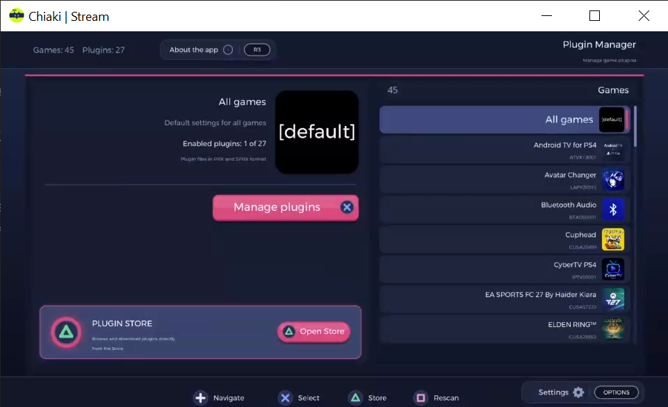
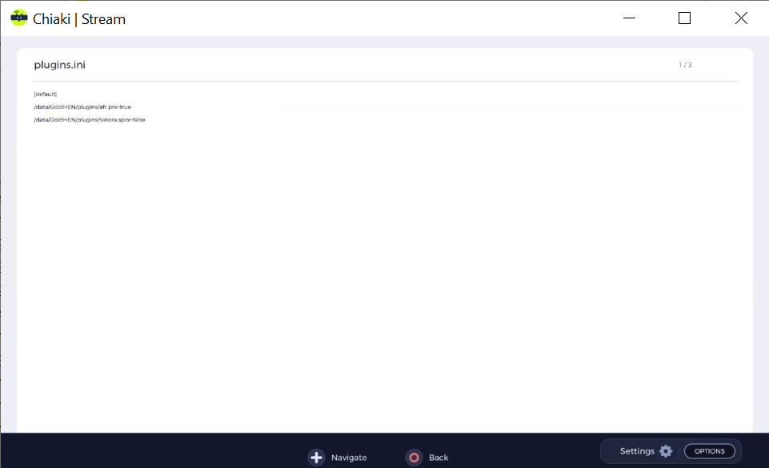
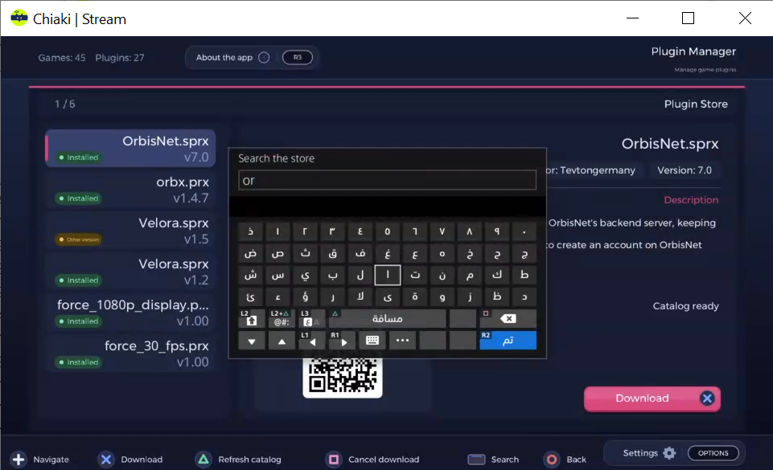
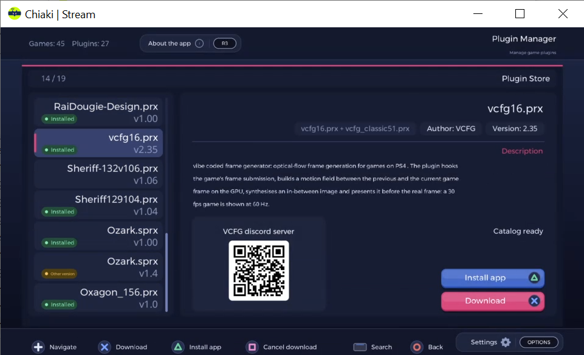
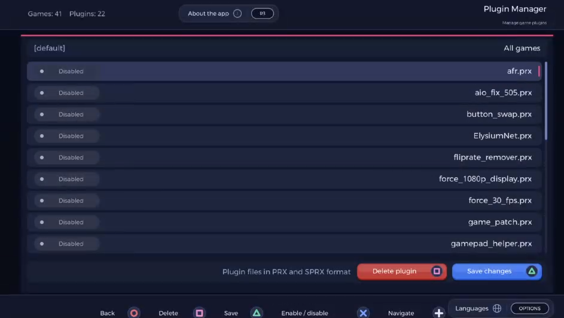
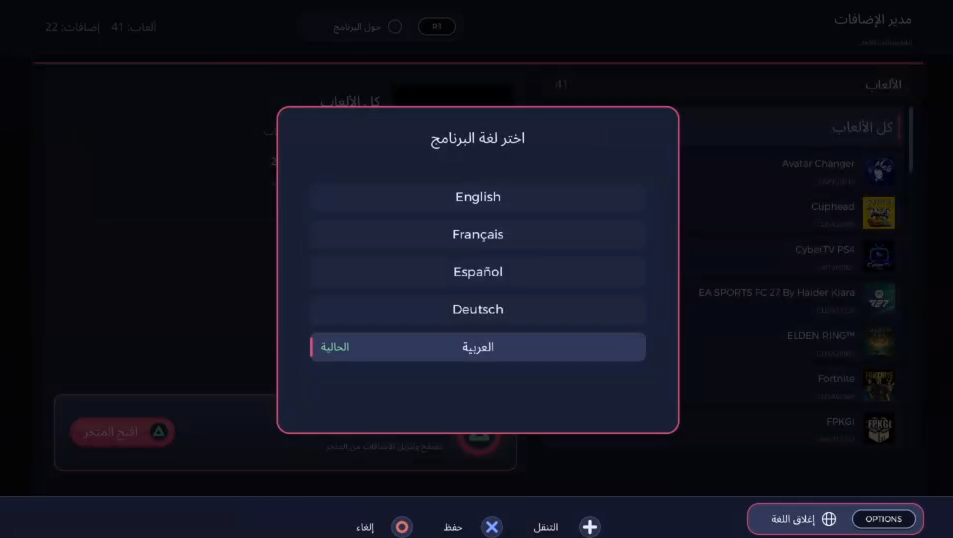

# Plugins Manager

A homebrew application for the PS4 that manages [GoldHEN](https://github.com/GoldHEN/GoldHEN) plugins directly on the console: browse a plugin store, install and update plugins, edit plugin tokens, and repair a broken `plugins.ini`. The interface is drawn with SDL2 and supports English, French, Spanish, German, Arabic, and Portuguese.

> **Requirements:** a jailbroken PS4 running GoldHEN. The app is built with the OpenOrbis toolchain and packaged as a PKG/fPKG.

## Screenshots

Screenshots were taken while streaming the console with Chiaki.

| | |
|---|---|
|  |  |
| Games list and per-game plugin settings | Viewing `plugins.ini` on the console |
|  |  |
| Searching the plugin store | Plugin details and install/download |
|  |  |
| Enabling and disabling plugins for a game | Language selection (6 languages) |

## Package info

Taken from `sce_sys/param.sfo`:

| Field | Value |
|---|---|
| Title | Plugins Manager |
| Title ID | BREW00421 |
| Content ID | IV0000-BREW00421_00-PLUGINSMANAGER00 |
| Version | 01.50 |
| Category | gde |

## Features

- **Plugin store.** Loads a JSON catalog, with a local cache for offline use, and supports search and filtering.
- **Install and update.** Downloads plugin files and ZIP packages into `/data/GoldHEN/plugins`, checks SHA-256 hashes, and detects installed plugins that differ from the catalog (update available).
- **Confirm dialog.** When a plugin is already present, the user chooses to replace everything, install only the plugin file(s), or cancel.
- **PKG installs.** Catalog entries can point to a PKG URL, which is sent to the console's Remote Package Installer (`127.0.0.1:12800`). The app never downloads these PKGs itself.
- **Support QR codes.** Shows a QR code from an image link, or generates one on the console from plain text such as a Discord invite.
- **Token editor.** Catalog entries can enable a token field that writes to a `.txt`, `.json`, or `.ini` file, using a configurable key path.
- **plugins.ini repair.** Detects and fixes common mistakes in `plugins.ini` (section headers, plugin paths, values). It backs up the original to `plugins.ini.bak` before writing.
- **Game list and icons.** Reads installed games through the root-access path (`libjbc`), with a GoldHEN FTP fallback that has a hard timeout.
- **Language selection.** The choice is saved to `/data/PluginManager/language.ini`.

## Catalog format

The store reads a JSON file (by default, `plugins.json` in the `pluginsJSON` repository). Each entry can include:

| Field | Purpose |
|---|---|
| `id`, `name`, `version`, `author` | Basic info |
| `description`, `descriptionAr` | Text (Arabic shown when the app language is Arabic) |
| `urlDownload`, `filename`, `sha256` | Plugin file |
| `url2download`, `filename2`, `sha256_2` | Optional second file |
| `packageUrl`, `packageSha256` | ZIP package |
| `pkgUrl` | Direct PKG, sent to the Remote Package Installer |
| `installPath` | Destination folder |
| `size` | Size in bytes, used to detect updates when no hash is given |
| `supportQR`, `support` | Support link or QR image |
| `tokenEnabled`, `tokenPath`, `tokenKey` | Token editor settings |

## Building

> The source archive does not include a build file (Makefile, CMakeLists, or `.gp4`/PKG project). The steps below are a general outline for OpenOrbis projects, and you will need to adapt the paths.

1. Install the [OpenOrbis PS4 Toolchain](https://github.com/OpenOrbis/OpenOrbis-PS4-Toolchain) and set `OO_PS4_TOOLCHAIN`.
2. Compile everything in `src/` (including `src/third_party/miniz/`, `src/jbc/`, and `src/stb_impl.cpp`).
3. Link with the SDL2, SDL2_image, and Sony system libraries used by the code (for example `-lSceSysUtil`, `-lSceNet`, `-lSceUserService`).
4. Package the ELF into a PKG or fPKG with the OpenOrbis tooling.

`PluginIniRepair.h` has no SDL or OpenOrbis dependencies, so its logic can be tested on a desktop machine.

## Project structure

```
src/
├── main.cpp            # UI loop, scenes, input, notifications
├── PluginStore.h/.cpp  # Catalog, downloads, hashing, install state, Remote Package Installer
├── PluginIniRepair.h   # Pure-logic plugins.ini repair (testable on a PC)
├── ZipPackage.h/.cpp   # ZIP package extraction (miniz)
├── RootAccess.h/.cpp   # Sandbox escape wrapper over libjbc
├── jbc/                # Kernel read/write and jailbreak helpers (C)
├── ArabicText.h/.cpp   # Arabic shaping and rendering
├── Language.h          # Language list, saved preference, translations
├── UiStrings.h         # UI string keys
├── QrCodeGen.h         # QR code generator (single header)
├── stb_image.h         # Image loading
├── stb_impl.cpp        # stb implementation unit
└── third_party/miniz/  # miniz (see its LICENSE)
```

## Paths used on the console

| Path | Purpose |
|---|---|
| `/data/GoldHEN/plugins` | Installed plugins |
| `/data/GoldHEN/plugins.ini` | GoldHEN plugin config (`.bak` and `.tmp` are created during repair) |
| `/data/PluginManager/` | App data: catalog cache, icons, language preference |

## Safety notes

- **Root access.** The root/sandbox-escape path depends on the console being jailbroken, with GoldHEN and a working exploit. Without these, it can crash the app. The app is designed to fall back gracefully where possible.
- **Config backups.** Editing `plugins.ini` always creates a `.bak` copy first. Keep your own backup of important configs as well.
- **Third-party plugins.** Plugins come from the catalog and the authors' links. Check what you install.

## Credits

- [GoldHEN](https://github.com/GoldHEN/GoldHEN) for the plugin loader
- [OpenOrbis](https://github.com/OpenOrbis) for the PS4 toolchain
- [miniz](https://github.com/richgel999/miniz) for ZIP handling (see `src/third_party/miniz/LICENSE`)
- [stb](https://github.com/nothings/stb) for image loading

## Author

Created and maintained by **Ayoub** ([@Ayoub-BLM](https://github.com/Ayoub-BLM)).

## Support

Discord: https://discord.gg/XW24zkCtP9

## License

<!-- TODO: add the license you use. The archive contains no LICENSE file for the project itself. -->
